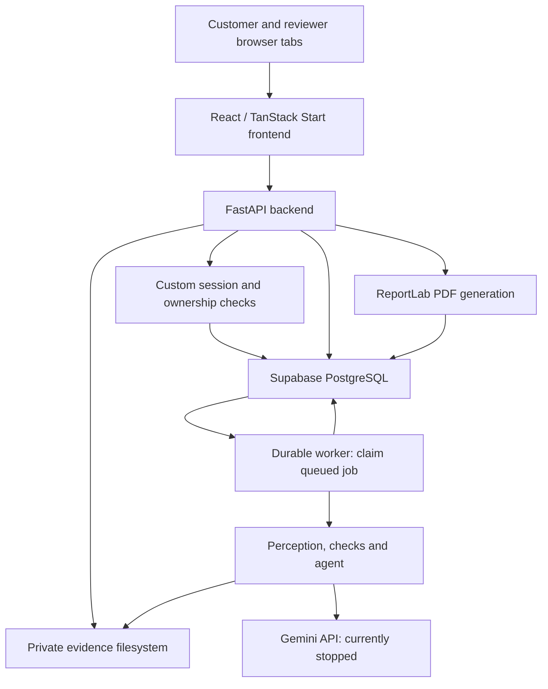
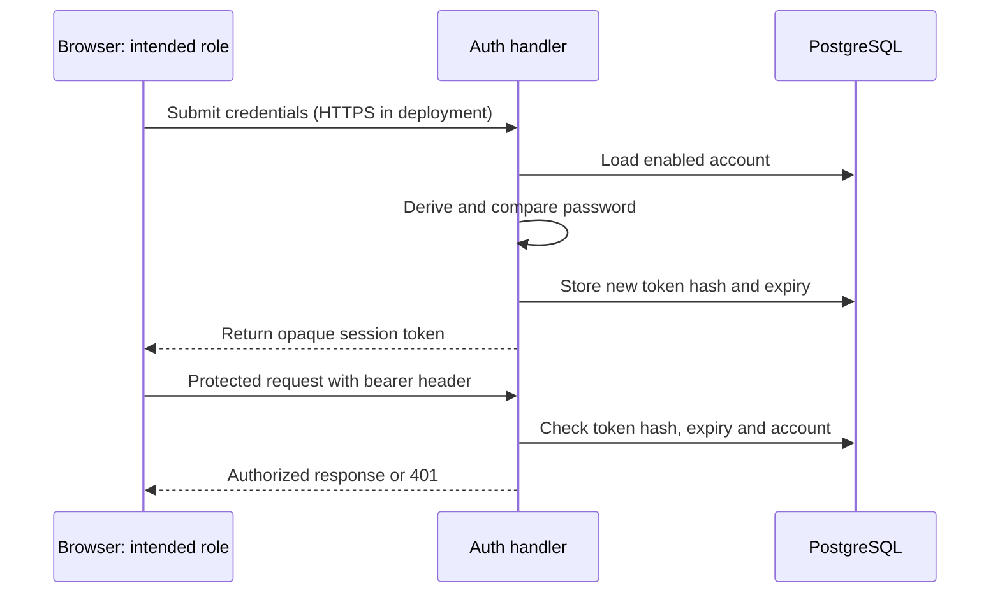
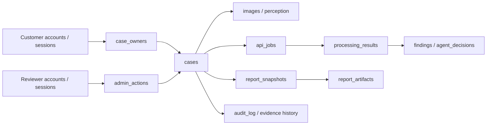

# FraudLens 2.0 — Mentor Guide

**Source audit: 21 October 2026 · Branch: `repair/analysis-pipeline-20261020`**

**Commit inspected: `a72e4fdc2d15b47de6c0da623a76df56ff9a8fe0`**

## 1. Project at a glance

FraudLens helps a human reviewer examine motor-insurance applications and photographic evidence. Customers submit applications and follow outcomes; reviewers inspect evidence, automated observations and reports, then approve, reject or request more photographs. It assists evidence review and routing. It does not prove fraud or automatically reject an applicant.

**Claims** concern an incident and requested repair payment. **Underwriting** concerns a vehicle's condition when applying for or renewing insurance; that inspection can become a later comparison baseline if its evidence actually establishes the condition.

| Status | What the current evidence establishes |
|---|---|
| Implemented | Customer/reviewer accounts, separate sessions, owned cases, durable jobs, checks, model adapter, versioned private PDFs and accountable human decisions. |
| Verified previously | Retained 21 October records support real local PostgreSQL/Chrome PDF and explicit manual-review workflows. Both accepted jobs remained failed; the successful workflow manifest says live AI was incomplete. |
| Blocked | The retained Gemini session ledger is stopped after HTTP 503 failures; its recovery failed. Successful end-to-end automated claims/underwriting qualification and historical reprocessing are not established. |
| Planned / unresolved | Representative real-world accuracy evaluation, stronger identity features, same-vehicle/view validation, and verified public backend/storage deployment. |

An earlier recovery probe and one unintended legacy-test request returned responses; neither establishes a complete case assessment. The accidental request has a separate audit; `test_llm.py` now requires explicit live-test opt-in. No live tests ran for this guide.

### Reading map

| Pages | Topic | Pages | Topic |
|---|---|---|---|
| 2–3 | Architecture, stack and frontend | 8–9 | Processing, all checks and worker |
| 4–5 | Login, authorization and database | 10–11 | Risk, reports and concise file map |
| 6–7 | Both workflows and API map | 12–13 | Local running, deployment and troubleshooting |
| 14–15 | Mentor explanation, walkthrough and questions | Appendix | Complete file, route and dependency inventory |

**Inspection boundary.** Actual code/configuration was read first. Eight pre-existing staged Markdown changes were included as supporting documentation; no uncommitted application source changes existed at inspection. No applicable `AGENTS.md` was found. Existing artifacts were read without rerunning their checks. This task did not start services, call APIs/models, connect to a database or change records.

The PDF contains a concise file map. The complete file-by-file appendix, route list and dependency classification are in [FraudLens_File_Inventory.md](FraudLens_File_Inventory.md). Keep that file beside this guide. The PDF and this Markdown describe the same guide; page markers organize the PDF.

<!-- PAGE -->

## 2. Architecture and technology stack

The browser runs the interactive interface. The frontend server renders web pages; the browser calls the separately configured Python API for account, evidence and case operations. A durable worker reads accepted jobs from PostgreSQL. It uses private files and persists results; it is not a request sent directly from the browser to Gemini.



| Technology / established version | Actual role |
|---|---|
| React / React DOM 19.2.7; TypeScript 5.9.3 | Components, browser interaction and compile-time type checks. |
| TanStack Start 1.168.27; Router 1.170.17 | Server rendering, hydration and file-based page routing. Hydration attaches browser interaction to rendered HTML. |
| Vite 7.3.6; Nitro 3.0.260903-beta | Build pipeline and generated server output; Nitro version is resolved in the lockfile. |
| Tailwind CSS 4.3.2 plus custom CSS | Utility styles and the application's own responsive layouts. |
| Python 3.12.8; FastAPI 0.141.1; Uvicorn 0.52.1 | Typed HTTP API and its application server. Pydantic 2.13.4 validates API models. |
| psycopg 3.3.6; psycopg-pool 3.3.3 | Backend SQL access to PostgreSQL, with bounded connection reuse. Supabase is the reported database host. |
| PyTorch 2.13.0+cpu; OpenCLIP 3.3.0; EasyOCR 1.7.2 | Local image features, admission screening and text recognition. |
| google-genai 2.18.1; C2PA Python 0.38.0 | Gemini adapter; local embedded content-credential verification respectively. |
| ReportLab 4.4.4 | PDF layout. Playwright 1.64.0, pytest 9.1.1, pypdf 6.20.1 and PyMuPDF 1.26.5 are verification tools. |

Versions come from manifests, lockfiles and backend pins; Python 3.12.8 is the existing virtual environment's metadata. `package.json` separates direct runtime and development dependencies. Backend pins include dependencies of dependencies and do not reliably identify original direct roots. The appendix classifies actual usage. Streamlit and research scripts are separate from the active product UI.

Local embeddings use CLIP `ViT-B-32` with `laion2b_s34b_b79k` weights; the optional artificial-image classifier is `umm-maybe/AI-image-detector`. Vision/perception, OCR and weather use separate caches. The adapter supports chat caching, but the production agent passes `conn=None`, so its database chat-response cache is inactive. Transactions are released before slow provider work.

<!-- PAGE -->

## 3. Frontend explained

`FraudLens-2.0-Frontend/src/routes/` defines pages. `router.tsx` loads the generated route tree; `routes/__root.tsx` supplies the page shell, metadata, styles and a React Query provider. `server.ts` wraps server-rendered responses with security headers. Page behavior becomes interactive after browser hydration.

| Route | Component / purpose |
|---|---|
| `/`, `/about` | `Home.tsx`, `About.tsx`: public project explanation. |
| `/claims`, `/underwriting` | `Agent.tsx`: public introductions to the two case types. |
| `/apply/claims`, `/apply/underwriting` | `Intake.tsx`, wrapped by `CustomerGate`: signed-in application forms. |
| `/dashboard` | `Dashboard.tsx`: owned customer cases, public outcomes and evidence requests. |
| `/admin` | `Admin.tsx`, `AdminOverview.tsx`, `CaseReview.tsx`: reviewer login, queue and case workspace. |
| `/track` | `Tracker.tsx`: authorized receipt/owner-based tracking. |

### From Submit to the API

1. `IntakeForm.choose` validates explicit files; preview object URLs are revoked on removal/replacement. Local evidence is never selected automatically.
2. `validate` and native HTML constraints check required fields, registration, phone, amounts, bank last-four and file limits. Underwriting requires all six UI photo slots.
3. `submit` builds native `FormData` with a stable UUID4 submission key and files, then calls `shared.tsx::api('submit')`. An in-flight ref prevents double clicks; errors preserve controls/files in that mounted form.
4. `mapFormData` maps registration to `vehicle_registration`, India incident date/time to an ISO timestamp, and files to repeated `images` parts.
5. `request` posts `/v1/cases` with the customer bearer and `Idempotency-Key`. Acceptance returns case/job references, not approval; dashboard polling follows processing.

`FieldSuggestions.tsx` is a reusable controlled field with a portal popup, filtering, hover/focus/touch behavior, arrow/Enter/Escape navigation and selectable fictional values from `sampleSuggestions.ts`. Selection fills one field and remains editable. Dependent make/model mismatches are warned about. Consent, passwords and files require explicit input. The current intake uses native forms, not React Hook Form despite that package being declared.

### State, errors and rendering

Business state uses React state/refs/effects. A Query Client is provided, but dashboard polling is implemented explicitly: customers poll about 2.5 seconds while awaiting decisions, slow to 30 seconds for final outcomes, back off on errors and slow hidden tabs to 60 seconds. Reviewer queue/detail polling is about 10 seconds. Cancellation and request counters prevent overlapping or stale updates. These are polling requests, not WebSocket subscriptions.

`customer-api.ts`, `shared.tsx` and `reportClient.ts` add the intended role's authorization and clear only that role on expiry. Requests have bounded waits and readable error states. Custom CSS provides responsive forms, galleries and contained table scrolling. Retained viewport tests support those layouts; physical phones, keyboards and assistive technologies were not newly tested here.

**Build-time configuration:** `VITE_API_BASE_URL`, `VITE_SAMPLE_SUGGESTIONS` and `VITE_PUBLIC_SITE_URL` are compiled into frontend output. Changing the backend URL after a production build requires rebuilding that frontend; changing a hosting setting alone does not rewrite existing JavaScript.

<!-- PAGE -->

## 4. Login and authorization — step by step

FraudLens uses custom opaque bearer sessions, not JWTs or Supabase Auth. An opaque token is random data that the server looks up; it does not contain a readable signed identity payload.

**Registration.** `customer_auth.install::register` validates name/email/password, normalizes email, inserts `customer_accounts`, audits registration and creates a session. Customer passwords require 12–1,024 characters. `runtime_store.password_hash` uses **PBKDF2-HMAC-SHA256, 600,000 iterations, a fresh 16-byte random salt and a 32-byte derived result**. This deliberately expensive derivation makes guessing harder. `password_matches` re-derives and compares with `hmac.compare_digest`.

**Login.** Customer `login` loads the normalized account, verifies the password and enabled flag, then calls `new_session`. Reviewer `api.login` checks `reviewer_accounts` using the same password primitive. A separate legacy bootstrap can authenticate against `ADMIN_EMAIL` and an environment SHA-256 password digest; it is weaker than the salted database-account path. The old direct-password header is additionally opt-in, not the normal browser login.



`secrets.token_urlsafe(48)` creates each login token. Only its SHA-256 digest is stored in `customer_sessions` or `admin_sessions`; expiry is fixed at eight hours. Account enabled state and a credential snapshot are rechecked, so disabling/changing credentials invalidates previous sessions. Logout deletes the presented session row. There is no refresh-token flow.

The browser uses separate **tab-scoped `sessionStorage` keys** for customer and reviewer sessions. `CustomerGate`, `customer-api.ts` and `Admin.tsx` check the intended session and handle 401 expiry. Normal tabs coexist; the backend enforces authority. Browser storage does not protect against malicious JavaScript.

| Identity | Server authority |
|---|---|
| Customer | Owned case details/images/outcomes; linking with a valid private receipt; requested evidence. |
| Viewer | Read reviewer data, traces and PDFs; prepare a report; no decision or reprocessing. |
| Reviewer | Read plus human decisions and reprocessing. |
| Admin | Reviewer powers plus account administration. A configured service capability is separate and cannot record human decisions. |

Provision an admin with `python scripts/manage_reviewer.py --db postgresql --email admin@example.test --role admin` from the backend directory using its Python environment. Use `--role reviewer` or `--role viewer` for restricted accounts. It prompts privately twice, uses PBKDF2, revokes prior sessions and audits changes. This command was inspected, not run.

`customer_auth.require_case/owns` checks SQL ownership; matching email/registration is insufficient. Linking historical cases requires an unexpired receipt and rejects another owner's case. Grants are hash-keyed for 30 days, **but `submission_receipts.response` retains the raw applicant capability for idempotent replay**. Email verification, recovery, MFA, social login and multi-organization tenancy are absent.

<!-- PAGE -->

## 5. Database and evidence storage

Supabase hosts the reported PostgreSQL database; browsers use FastAPI rather than direct SQL. `db.configured_target` prefers an explicit target, then PostgreSQL if `DATABASE_URL` exists, otherwise SQLite. Pilot startup selects PostgreSQL and schema `fraudlens_pilot`, a named table namespace. Failed connections do not silently fall back to SQLite.

`postgres.connect` pools connections (default eight; range 3–16), sets schema/search paths and timeouts, and requires remote TLS. GET transactions are read-only consistent snapshots; writes commit/roll back explicitly. Slow provider work releases optional transactions. SQLite remains an explicit test/research/rollback option with local locking.



These are logical links: some image/run memberships are JSON identifier lists, not foreign keys. JSON and vectors are TEXT; pgvector is absent.

| Records | What persists |
|---|---|
| Accounts, sessions, `case_owners` | Password/session hashes, enabled roles, expiry and explicit customer ownership. |
| `cases`, `claimants`, `images` | Application facts, identity references, image paths, hashes, vectors and EXIF. Claimant association is not a declared case foreign key; there is no garages table. |
| `perception_records`, `image_artifacts`, `cache_entries` | Reusable observations, image-role provenance and namespaced caches. |
| `api_jobs`, `findings`, `agent_decisions`, `processing_results` | Durable attempts and exact run membership, findings, routing and convergence. |
| `applicant_grants`, requests/batches/receipts | Limited applicant access, requested evidence history and idempotent acceptance responses. |
| `report_snapshots`, `report_artifacts` | Frozen JSON and base64 PDF bytes, version, checksum, timestamps or generation failure. |
| `admin_actions`, `audit_log` | Separate human decisions and chronological actor/run/evidence events. |

Migrations `migrations/postgresql/001_initial.sql` and `002_customer_workflow.sql` define **24 application tables**, plus version/import tables `schema_migrations` and `migration_imports`. `pg_migrations.py` verifies SQL checksums. Installation/upgrade is an explicit transaction, not HTTP startup behavior. Private grants and row-level security exclude browser roles; backend SQL enforces application access.

**Private files** hold original evidence, thumbnails, weights and provider-control ledgers. SQL holds paths, report derivatives and PDF bytes. Supabase Storage is not integrated; SQL backups alone omit originals.

Idempotency fingerprints and expected revisions/run/evidence prevent duplicates and stale decisions (§6). Backups need SQL **and** files/config; restores require a new namespace. Preserve both across restarts. Reports dated 20–21 October 2026 describe 822 cases and 1,465 references; **current counts were not queried**.

<!-- PAGE -->

## 6. Complete claims workflow

Consider a fictional collision claim with an estimate and original photos. Applicant statements remain unverified declarations.

| Transition | Responsible implementation and saved record |
|---|---|
| Sign in and enter facts | `CustomerGate` and `IntakeForm`: applicant/contact, policy, vehicle, insured value, incident date/time/location, amount, garage, narrative and applicable settlement details. Select suggestions individually or type; consent remains explicit. |
| Select and validate evidence | Native file chooser and previews; API `submit_case` decodes JPEG/PNG/WebP, checks nonempty files, up to 12, at most 5 MB and 25 megapixels each. Local CLIP admission requires at least one likely vehicle image; this is not authenticity verification. |
| Accept once | `shared.tsx::api` sends multipart data and UUID4 idempotency key. `api.submit_case` fingerprints fields, owner and ordered photo hashes. Same key/payload replays acceptance; changed payload conflicts. |
| Persist and queue | One SQL transaction records case, owner, images, applicant grant, evidence batch, audit, job and receipt. Coordinated file cleanup handles confirmed rollback; uncertain commit preserves accepted evidence. |
| Process in background | `DurableWorker` claims `api_jobs`; `api._run_pipeline` performs perception, policy checks and agent routing, then saves findings, decision, exact `processing_results` and report snapshot. |
| Inspect report | Reviewer opens `CaseReview`: submitted facts, photos, Desk Review and report controls. A failed job may still produce a useful explicitly partial report. |
| Ask for evidence | Human action stores specific artifacts plus separate public wording. `submit_evidence` verifies ownership/receipt and an open request, appends new photos/batch, closes request and enqueues a new run. Older evidence/reports survive. |
| Decide and inform | `record_action` validates human role, current run/evidence and revision; saves `admin_actions` and audit. Customer dashboard polling receives the public outcome, not private investigator notes. |

Queued/running cases cannot receive a human decision. A failed or unavailable analysis requires explicit manual-review acknowledgement and a written basis for approval/rejection. Rejection requires a customer-visible explanation. An approved claim can therefore still have **failed processing**; these are separate records and meanings.

## 7. Complete underwriting workflow

Underwriting reuses authentication, intake, worker and reports. Reviewers approve, reject or request evidence with the same audits. They assess condition and evidence when issuing/renewing cover.

`Intake.tsx` changes fields for application type, previous policy/no-claim information, insured value and declared condition. It requires six explicitly selected slots: four corners, odometer and registration plate. The backend accepts a photo collection and indexes it; it does **not independently certify all six views or that all photos show one vehicle**.

The production underwriting policy selects ten checks. Shared image checks and entity relationships apply; claim amount/garage billing, prior-baseline linkage and claim severity progression are claims checks. `baseline_corruption` is retained only as a zero-weight experimental observation. `view_completeness` is registered research code but selected by neither production policy.

A later claim can use underwriting photos through `BaselineLinkageCheck` when registration/policy, time and usable undamaged observations support the link. Human approval or an underwriting application alone does not certify an undamaged baseline.

<!-- PAGE -->

## 8. API map and integrations

An API endpoint is an HTTP method plus path. Static inspection found **38 explicit application method/path registrations** in `api.py` and the installed customer/evidence/report modules. The appendix contains the complete handler/access table; no live API was called to extract it.

Here **R** means the read-capable reviewer family (admin/reviewer/viewer; configured service capability also accepted). **H** means human admin/reviewer only. **C** means a signed-in owning customer. A receipt is a separate limited, case-bound capability.

| Method | Path | Purpose | Access |
|---|---|---|---|
| POST | `/v1/customer/auth/register` | Customer registration | Public validation |
| POST | `/v1/customer/auth/login` | Customer login | Public credentials |
| POST | `/v1/auth/login` | Reviewer login | Public credentials |
| GET | `/v1/customer/cases` | Owned case list | Customer |
| POST | `/v1/customer/cases/link` | Link an unowned case | Customer + receipt |
| POST | `/v1/cases` | Multipart acceptance | Customer or anonymous receipt flow |
| GET | `/v1/cases` | Reviewer queue | R |
| GET | `/v1/cases/{case_id}` | Current case detail | R |
| GET | `/v1/jobs/{job_id}` | Safe job status | R, owner or receipt |
| POST | `/v1/cases/{case_id}/action` | Record human action | H |
| POST | `/v1/cases/{case_id}/evidence` | Requested photos | Owner or receipt |
| POST | `/v1/cases/{case_id}/reprocess` | Enqueue another run | Admin/reviewer/service |
| GET | `/v1/cases/{case_id}/reports` | List saved versions | R |
| POST | `/v1/cases/{case_id}/reports/prepare` | Prepare saved PDF | R |
| GET | `/v1/cases/{case_id}/reports/{snapshot_id}/pdf` | Preview/download bytes | R |
| GET | `/health`, `/v1/health`, `/ready` | Diagnostics / readiness | Public; no model probe |

FastAPI additionally registers `/openapi.json`, `/docs`, `/docs/oauth2-redirect` and `/redoc` with GET/HEAD. The OAuth helper's existence does not mean OAuth login is used. CORS preflight OPTIONS handling belongs to middleware.

### Four different connection types

Browser-to-backend routes are internal application HTTP. Gemini vision/adjudication calls use the external `google-genai` API. Open-Meteo historical weather is conditional HTTP when the scene check has usable time/location/vision and no cached result. CLIP, EasyOCR, C2PA and forensic calculations run locally. The “external corpus” is a local reference index, not a TinEye/Google reverse-image service. PostgreSQL uses a separate server-side SQL connection. Ollama is an explicit optional local provider, with no automatic failover.

FastAPI/Pydantic validate request/response shape; domain guards check meaning. Cross-origin resource sharing (CORS) permits browser requests from exact configured origins; localhost and its numeric address differ. Bearer headers carry authorization. Errors have stable codes and sanitized descriptions.

`/health` summarizes database/job/provider configuration without a live model probe. `/ready` tests evidence-directory writability and SQL access, returning 503 on failure. Neither establishes Gemini success or production readiness. No health/readiness route was called for this guide.

<!-- PAGE -->

## 9. Real processing, checks and agent — image evidence

`api.submit_case` prepares and accepts evidence before worker processing. It computes original-byte SHA-256, pHash/dHash, a normalized 512-number CLIP vector and EXIF. SHA-256 identifies exact bytes; perceptual hashes tolerate modest visual changes; embeddings support approximate similarity. None proves ownership or authenticity.

The worker calls `perception.perceive_image`, then `orchestrator.process_case` runs checks and `engine.adjudicate`. Production does **not** sum a score before the agent. It saves decision, exact findings/evidence/run membership, explanation and report; research baseline arithmetic is separate.

Perception records visible damage, severity, plate text, scene, weather, lighting and shadows. It first reuses compatible content-hash observations/request cache. Failed or malformed cached output is not success. A strict schema can request one corrected response; “one image always costs exactly one call” would be inaccurate. Unavailable required vision disables successful adjudication; supported local checks still run.

### Registered image checks

Weights shown here belong to the research baseline and are context for production, not production score coefficients. All eight image checks below are selected by both production case types.

| Check / weight | Evidence and output | Limitation |
|---|---|---|
| `internal_duplicate` / 1.0 | Other-case CLIP cosine and perceptual distance. Concern: cosine ≥0.90 and distance ≤8 or cosine ≥0.95. | Same-case images excluded. Similarity/reuse can have innocent explanations; prospective accuracy unverified. |
| `external_corpus` / 1.0 | Same matching rules against the local external reference index. | Research reference membership is not a web-wide search or evidence of applicant intent. |
| `exif_metadata` / 0.7 | Software tags, GPS distance and capture time. >100 km can concern; >48 hours is inconclusive. | Missing EXIF is inconclusive. Metadata is editable and time comparison is qualified. |
| `plate_ocr` / 0.3 | EasyOCR reads a registration candidate and compares declaration; mismatch needs confidence ≥0.5. | Unreadable/uncertain plates abstain. Candidate can belong to another vehicle; regex excludes some formats. |
| `c2pa_credentials` / 0.1 | Local embedded content-credential validation; specific content/signature mismatch can concern. | Missing/untrusted credentials are inconclusive; SDK errors are failed, not manipulation. Remote manifest/OCSP fetching is disabled. |
| `scene_consistency` / 1.0 | Vision cues, qualified time/location, local sun geometry and optional cached historical weather. | Missing time, coordinates or readable cues limits coverage. Weather outage is not fraud. |
| `ai_generation` / 0.0 | Local experimental artificial-image classifier observation. | Demoted after poor/inverted research discrimination; inconclusive in production. |
| `digital_edit` / 0.0 | Local compression, noise and edge measurements. | Weak/calibration-dependent research signal; production forces inconclusive. |

The registered classes live in `FraudLens-2.0-Backend/src/checks/`. `base.py::_run_one` handles applicability, missing perception and exceptions per check. A crash becomes an inconclusive verdict with failed execution state, not a passing result. A compatible OCR cache stores raw recognition observations; the comparison is recomputed for the current declaration.

<!-- PAGE -->

## 9. Processing continued — case checks and durability

### Remaining registered checks

| Check / weight / selection | Evidence and output | Limitation |
|---|---|---|
| `threshold_gaming` / 1.0 / claims | Current amount in INR [45,000, 50,000), garage ≥5 claims, >40% in that band. | Garage-level pattern, not claimant guilt; benchmark is not a verified current legal rule. |
| `damage_plausibility` / 0.7 / claims | Worst severity: INR ceilings 2,000 / 25,000 / 70,000 for none / minor / moderate; concern above 1.5× ceiling. | Hand-set ranges are not an estimator. Severe damage is unbounded; vision can be missing/wrong. |
| `entity_graph` / 1.0 / both | At least two shared identifiers between distinct claimants, or at least three vehicles for one claimant at a real garage. | Stored-field relationships only; a link is not collusion or intent. Missing repairer is not a real garage. |
| `baseline_linkage` / 1.0 / claims | Linked underwriting within 30 days, usable undamaged baseline and current moderate/severe damage. | Requires actual established observations; intervening genuine damage remains possible. |
| `severity_progression` / 1.0 / claims | Same-registration severity chronology; unexplained down/up or same-panel repeat within 90 days. | Approximate panel vocabulary, incomplete repair records and timezone uncertainty limit interpretation. |
| `baseline_corruption` / 0.0 / underwriting experimental | Historical declaration-versus-damage observations. | Production corrects assumed undamaged declarations and forces inconclusive; not validated baseline-fraud detection. |
| `view_completeness` / 0.0 / neither production list | Research view similarity/count and plate coverage. | Registered, but not selected. Slot labels and visual diversity do not prove same vehicle or six-view completeness. |

There are **15 registered checks**: claims selects 13, underwriting ten. `checks/retired/vehicle_consistency.py` is outside the registered battery. Experimental observations are retained for audit but cannot become production evidence of fraud merely because a classifier returned a number.

### Agent actions and cache boundaries

`agent/tools.py` offers four allowlisted tools: `widen_similarity_search`, `get_claimant_history`, `get_garage_history` (claims) and `requery_perception`. They query stored/local information. Despite its name, requery returns an existing usable perception record; it does not make a new vision call. Recorded `TraceStep`s contain tool actions, concise observations, timing, guards and citations, not hidden model reasoning.

Retrospective comparisons exclude later cases/photos using a trusted as-of cutoff that tools cannot widen. Historical batch execution also requires fresh successful claims/underwriting validation, matching evidence hashes and original budget; failed recovery does not satisfy that gate.

### Durable execution and failure meanings

`DurableWorker` claims database jobs rather than losing them when an HTTP request ends. PostgreSQL uses one schema-scoped advisory-lock leader, a heartbeat, `FOR UPDATE SKIP LOCKED`, leader epochs and secret execution tokens. Fencing rejects a stale worker's final writes. SQLite instead uses an OS lock. Restart recovery reuses an already saved result or requeues interrupted ownership attempts up to three; a terminal model failure is not retried forever. Human reprocessing creates another run.

<!-- PAGE -->

## 10. How risk and recommendations are calculated

The repository has two decision paths. **Production uses model routing. The research baseline uses an additive heuristic.** Calling both “the fraud score” would hide a material difference.

| Production agent | Research baseline |
|---|---|
| `production_policy`, `engine.adjudicate` and `_build_decision` | `baseline.score_case`, `band_for`, `decide` |
| Model selects a routing band from submitted facts and recorded findings. | Sums registered weight × confidence for each CONCERN finding. |
| Persisted numeric `score=None`; explanation says numeric value not computed. | Saves score rounded to four decimals; compares the unrounded sequential sum with thresholds. |
| Citations, observations, eligibility, coverage and overrides explain the route. | PASS and INCONCLUSIVE add zero; zero/unknown/retired weights add zero. |
| Confidence: 0.70 for clear, 0.75 for other converged routes, 0.30 for fallback; not calibrated fraud likelihood. | Repeated findings each add; there is no normalization, correlation discount or score cap. |

### Actual baseline rule and illustrative example

**S = Σ [registered check weight × finding confidence], for every CONCERN.**

| Unrounded S | Band | Routing meaning |
|---|---|---|
| S < 0.3 | `clear` | Automated clear/approve recommendation, not a human approval. |
| 0.3 ≤ S < 0.6 | `request_evidence` | Ask for specific missing evidence. |
| 0.6 ≤ S < 1.0 | `desk_review` | Human desk assessment. |
| S ≥ 1.0 | `escalate_siu` | Refer to the Special Investigation Unit/human specialist. |

**Illustrative, fictional baseline only:** an EXIF concern with confidence 0.85 and weight 0.7 contributes 0.595. A plate mismatch concern with confidence 0.8 and weight 0.3 contributes 0.24. Other PASS/INCONCLUSIVE findings contribute zero. S = **0.835**, therefore desk review. This is neither a live assessment nor the calculation of the production agent. An unbounded heuristic score is not a probability or percentage.

### Production eligibility and safeguards

`production_policy.py` adds scenario corrections, qualifies corpus reliability, excludes zero-weight observations as routing grounds, and treats applicant/tool text as untrusted. Missing inputs are not clean results. The frozen explanation marks registered, nonzero-weight, completed CONCERN evidence eligible and records weights as context; it does not compute an additive production score.

The agent is limited to eight iterations and 15 tool executions, with one invalid-schema correction. Unknown finding citations are discarded. A request-evidence route without an artifact gets a concrete original-photo request. Recognized rejection wording is guarded toward escalation; the decision types have **no automatic reject option**. Failed provider/invalid repeated output yields a nonconverged desk-review fallback. Missing required vision prevents successful adjudication.

`assessment_explanation.explain_assessment` saves routing source, exact finding references, observations, parameters and coverage. It flags missing historical explanations instead of inventing a formula afterward. Production policy version is `agent-production-{claims|underwriting}-2026-10-14-v3`; check implementation revision and PDF template versions are separate. The human's approve/reject/evidence-request record remains a separate, attributable decision.

<!-- PAGE -->

## 11. Reports, admin review and concise file map

`api._build_report` assembles the current run's saved findings, decision, considered evidence, explanation and applicable human action. `_snapshot_report` freezes JSON in `report_snapshots`. Its basis includes run/status, decision, human revision, evidence IDs, case status and template; unrelated corpus changes do not create another report version.

`report_pdf.enrich_snapshot` freezes image thumbnails and coverage. `prepare_report` commits the snapshot read before ReportLab rendering and saves base64 bytes/checksum in `report_artifacts`. Existing successful bytes are reused. A generation failure records a sanitized error and returns `PDF_GENERATION_FAILED`; retry PDF preparation, not case analysis. A new current snapshot is blocked while a run is active, but selected historical reports remain available.

`ReportPanel.tsx` and `reportClient.ts` fetch through the authenticated reviewer client, create a browser blob URL and preview it in a dialog/iframe or download it. URLs are revoked when no longer needed. A mobile open/download fallback is provided. Preview/download neither invokes checks nor calls Gemini. Internal reviewer PDFs are not exposed through a customer PDF route.

The current renderer is `fraudlens-pdf-2026-10-21-v3`. It keeps headings with content; v2 and legacy v1 dispatch plus all saved bytes remain supported. Human review creates before/after versions without rewriting earlier reports. Unknown or earlier human review bases are labeled. Retained v3 browser evidence supports matching preview/download/API bytes and nine inspected pages; those were earlier application-report checks, not this guide's PDF generation.

The implemented admin layout is vertical: status, application details, photographs, three factual Desk Review sentences with PDF controls, human actions and timeline. Reviewer diagnostics are collapsed; viewer retry/actions are restricted. No pending UI redesign is evidenced by the inspected working tree. Deferred deployment/identity work is a separate limitation.

### Where to read next

All paths below are relative to the repository. The appendix gives every relevant first-party file and its callers; this table is the short reading route.

| Area | Main path(s) and purpose |
|---|---|
| Page entrypoints | `FraudLens-2.0-Frontend/src/routes/`; experience components are in `src/experience/` beneath that frontend. |
| Intake and browser requests | Frontend `src/experience/Intake.tsx`, `shared.tsx`, `customer-api.ts`, `CustomerSession.tsx`. |
| Reviewer workspace/PDF | Frontend `Admin.tsx`, `CaseReview.tsx`, `reviewPresentation.ts`, `ReportPanel.tsx`, `reportClient.ts` in `src/experience/`. |
| HTTP and identity | `FraudLens-2.0-Backend/src/api.py`, `customer_auth.py`, `evidence_workflow.py`. |
| Persistence and jobs | Backend `src/db.py`, `postgres.py`, `pg_migrations.py`, `runtime_store.py`, `durable_worker.py`; `migrations/postgresql/`. |
| Analysis and explanation | Backend `src/ingest.py`, `perception.py`, `checks/`, `agent/`, `orchestrator.py`, `assessment_explanation.py`, `llm.py`. |
| PDFs / operations / research | Backend `src/report_pdf.py`, `scripts/`, `test_*.py`; legacy `app.py` is Streamlit. Root handovers preserve dated evidence. |

[Open the complete file/route/dependency inventory](FraudLens_File_Inventory.md). Dependencies, model/data folders and generated outputs are grouped there rather than expanded into thousands of files.

<!-- PAGE -->

## 12. Local running and deployment

These commands were checked against current scripts and prior local verification. They are **instructions for a later intentional run**, not commands executed to write this guide. Start from the repository root; use separate terminals. Existing dependencies, private configuration, model caches and preserved control files are prerequisites.

### Build first, then start the three processes

Configure `FRAUDLENS_NODE22_HOME` to your own installed Node 22.23.3 directory. The helper checks `.nvmrc`; no private machine path is reproduced here.

```powershell
Set-Location .\FraudLens-2.0-Frontend
$env:VITE_API_BASE_URL = 'http://127.0.0.1:8001'
$env:VITE_SAMPLE_SUGGESTIONS = 'true'
.\scripts\node22.ps1 -Task typecheck
.\scripts\node22.ps1 -Task build
```

In a new terminal at the repository root:

```powershell
Set-Location .\FraudLens-2.0-Backend
.\scripts\start_pilot.ps1 -Database postgresql `
  -Schema fraudlens_pilot -Port 8001 -NoWorker
```

Wait for model warmup/application startup; then, in another root terminal:

```powershell
Set-Location .\FraudLens-2.0-Backend
.\scripts\start_pilot.ps1 -Database postgresql `
  -Schema fraudlens_pilot -WorkerOnly
```

After the frontend build, serve it from the frontend terminal:

```powershell
$env:HOST = '127.0.0.1'; $env:PORT = '5173'
& (Join-Path $env:FRAUDLENS_NODE22_HOME 'node.exe') `
  .output/server/index.mjs
```

Customer: `http://127.0.0.1:5173/dashboard`; reviewer: `/admin` on that origin; backend docs: `http://127.0.0.1:8001/docs`. The helper refuses an occupied API port; it does not kill another process. Default model warmup matters: a dated cold six-photo acceptance took about 199 seconds. A warmup is local computation, not a provider probe.

### Deployment boundary: Vercel and Render

The user reports a Vercel frontend deployment; `vercel.json` configures TanStack Start. No public URL/connectivity was validated here. A deployed frontend alone does not establish that its backend is deployed, reachable or configured with matching CORS.

No Render blueprint was found. Existing `railway.json` uses `python scripts/start_deployment.py --embedded-worker`. The same platform-independent entrypoint documents prerequisites relevant to a Render backend: Python dependencies, `PORT`, PostgreSQL/schema, exact HTTPS CORS origins, model caches and an existing private persistent root containing evidence and original control ledgers. A fresh/needed schema upgrade is an explicit backed-up migration operation, not an automatic deployment reset.

API and worker require access to the **same private evidence files and provider-control files**. Separate processes are supported on one host/shared volume; do not assume independently hosted services share a filesystem. Verify that topology/storage on the actual host or change the storage design later. Supabase Storage, TLS/public CORS, retention after redeploy and backend hosting remain unverified; no hosting action was performed for this guide.

<!-- PAGE -->

## 12. Troubleshooting and verification boundaries

Use existing source, configuration names and sanitized local status artifacts first. The following are diagnostic directions, **not instructions to reset controls, resubmit cases or call external APIs**. Do not paste secret values into logs/screenshots.

Job states are queued/running/completed/failed/interrupted. `needs_review` is a stage; `partial` describes report coverage. Completion requires usable required vision and converged routing, although individual checks can remain inconclusive. Human approval/rejection, job state, check execution, finding verdict and routing band are separate facts.

| Symptom | Safe first inspection / meaning |
|---|---|
| Login failure | Confirm customer versus reviewer screen/account/schema, enabled state and typed email. Inspect sanitized failure code. Reviewer provisioning is separate from customer registration; no default password is supplied. |
| Backend unreachable | Compare built `VITE_API_BASE_URL` with intended API origin/port; inspect startup log and whether its process exited. Rebuild later if the compiled URL is wrong. |
| Browser CORS error | Compare exact frontend scheme/host/port with backend `CORS_ORIGINS`; inspect browser's existing error. A successful local setup does not validate a deployed origin. |
| Case stays queued | Read existing operations/job logs for worker warmup, leadership, lost connection or absent worker. Accepted data can be safe while processing has not started. Do not enqueue a duplicate. |
| `processing_failed` | Separate provider/perception failure from check failures using saved stage and sanitized root-failure details. Inspect the exact saved run; a partial report may still support deliberate human review. |
| Gemini persisted stop | Inspect existing session/quota status and retained audit. A quota-day or chat-limit reset does not reopen the session circuit. Do not delete ledgers, rotate keys, switch providers or run another probe as a shortcut. |
| Missing evidence | Check authorized path references, file availability and earlier backup manifests without altering records. SQL backup alone does not contain originals. Preserve uncertain-commit files. |
| PDF unavailable | Distinguish active-run pending, selected version and generation failure. Inspect saved artifact/error status. A later authorized report-render retry should reuse analysis; reprocessing is not a PDF fix. |

### What has actually been verified?

Retained records corroborate local PostgreSQL/worker execution, separate tabs, manual outcomes, PDFs and viewport checks; `live_ai_complete=false`. The past **41-check integrity audit** covered seven evidence hashes, six PDFs and unchanged original rows/controls. It was not rerun and is not accuracy evidence or current row counting.

The retained ledger has four application attempts: 503, 503, successful probe, 503; recovery is failed. The accidental request was separate. Source confirms the live-test opt-in guard; nothing was executed here. Partly synthetic/scenario-injected research and known false positives do not establish independent deployment accuracy. Physical devices/accessibility, multi-tenant security and production load/privacy remain unverified.

### Unresolved facts

The source cannot establish the public Vercel URL's backend connection, whether a Render service/volume exists, current cloud grants/row counts, current provider health or representative real-world accuracy. Those questions require separately authorized environment checks or evaluation, not assumptions in a mentor presentation.

<!-- PAGE -->

## 13. Mentor presentation — a two-minute explanation

“FraudLens is a motor-insurance evidence-review application with two paths: claims after an incident and underwriting when assessing a vehicle for cover. A customer signs in, enters application details and explicitly uploads photographs. A reviewer uses a separate normal browser tab to inspect that case and record the final decision.

“The frontend is React and TypeScript with TanStack routing. It calls a Python FastAPI backend. We use our own password-hashed accounts and random bearer sessions; Supabase hosts PostgreSQL, rather than providing login. Ownership is checked on the server, so knowing a case ID or email does not grant access.

“Submission persists the case and a durable job. A worker then uses local image features and OCR, reusable vision observations, policy checks and a bounded Gemini agent when available. The agent recommends routing and cites evidence; it cannot automatically reject. Production routing has no additive fraud probability. A separate research baseline demonstrates a weighted heuristic and its limits.

“Reports come from saved run-specific snapshots. Preview and download reuse stored PDF bytes, and human decisions produce traceable versions without rewriting the original report. Processing status, evidence completeness and human approval are deliberately separate.

“The local PDF and manual-review workflow has recorded verification. End-to-end live AI qualification is still blocked by a persisted provider stop, so the current presentation must show partial analysis honestly. The next work is controlled live qualification, better representative evaluation, stronger identity operations and verified deployment/storage.”

### Short two-tab walkthrough

1. In a customer tab, sign in and open a claims application. Show one field-specific fictional suggestion, edit it, and choose legitimate local evidence explicitly. Never show real applicant data or a private receipt to the mentor.
2. Submit only as part of a separately authorized demonstration. Explain that the confirmation means accepted/queued, not approved. For a documentation-only talk, use a sanitized previously recorded example instead.
3. In an ordinary reviewer tab, sign in independently and open the case. Explain application facts, photographs, Desk Review, processing state and evidence gaps.
4. Open a saved PDF version. Explain that this reads persisted analysis rather than calling a model again; compare the separate human-decision section if present.
5. Explain the approve/reject/evidence-request controls and stale-run safeguards. Any real action writes history and requires authorization; a read-only mentor explanation can stop before recording it.
6. Show how the customer's public outcome differs from internal notes. Describe underwriting's six photo slots and its same-vehicle verification limitation.

<!-- PAGE -->

## 13. Likely mentor questions

| Question | Concise answer |
|---|---|
| Why this stack? | React/TypeScript organizes the interface; FastAPI validates an explicit HTTP contract; Python hosts image/ML tooling; PostgreSQL supports durable relational history. Existing project capabilities were extended rather than replaced. |
| Why Supabase/PostgreSQL? | It supplies persistent SQL records and transaction/locking support for accounts, jobs, reviews and report history. Supabase Auth/Storage are not automatically in use just because the database is hosted there. |
| How is login secured? | Database accounts use salted PBKDF2-HMAC-SHA256 at 600,000 iterations. Random sessions are hash-keyed, expire after eight hours and are checked against enabled/current credentials. A legacy bootstrap path and absent MFA/recovery remain limitations. |
| Why a separate worker? | Slow image/OCR/model work should survive browser/request loss and be recoverable after process failure. Database leadership, attempts and fencing prevent a stale worker from persisting competing results. |
| What does AI contribute? | CLIP provides local visual features, OCR reads text, and Gemini can provide visible observations plus evidence-based routing/tool selection. Experimental detector numbers are qualified; missing AI is disclosed rather than fabricated. |
| How is risk explained? | Production stores routing, citations, observations, rule parameters and coverage with no numeric score. Only the research baseline sums weighted concerns. Neither path is a calibrated fraud probability. |
| What distinguishes real findings from fallback? | Findings record their check, evidence, verdict and execution state. A fallback routing record explicitly says model adjudication did not converge; an available report/manual approval does not convert that fallback into successful AI analysis. |
| How accurate is the system? | The repository contains dated research/scenario measurements, not independent current deployment accuracy. Corpus design, weak detectors, missing perception and known false positives prevent claiming perfect or broadly validated fraud detection. |
| What are the main limitations? | Persisted provider stop; incomplete live qualification; photo identity/coverage uncertainty; optional/missing evidence; one organization; absent recovery/MFA/email verification; private-file deployment and public connectivity not verified. |
| What should be developed next? | Restore provider work only under explicit controls, qualify both complete workflows, evaluate representative labeled data and error costs, strengthen photo/baseline validation and identity/security operations, then verify deployment and durable storage. |

### Sources and how to use the appendix

Primary sources: current entrypoints, route handlers, SQL, policies/checks and manifests. Supporting records: `ANALYSIS_REPAIR_VERIFICATION.md`, `ANALYSIS_REPAIR_HANDOVER.md` and earlier presentation verification; overlapping outcomes were not added together.

The [complete Markdown appendix](FraudLens_File_Inventory.md) covers files, symbols, callers, all routes, dependency classifications and grouped exclusions. Keep it beside this guide. This ReportLab PDF was text-extracted and rendered for inspection; documentation made no application changes, live AI requests or database writes.
